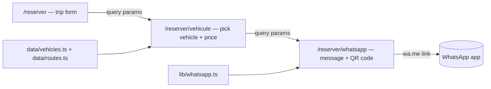

# Structure

## Top-Level Layout

- `src/app/` — routes (App Router: one folder = one URL), global layout,
  global CSS.
- `src/components/` — shared React components (named after Figma components).
- `src/data/` — all editable content/config (no page should hardcode copy
  that belongs here).
- `src/lib/` — framework-free helpers (`whatsapp.ts`, `booking.ts`,
  `query.ts`).
- `public/images/` — static images; see README section 5 for the expected
  filenames (many are still placeholders/missing).

## Entry Points

- `src/app/layout.tsx` — root layout: fonts, metadata, renders `Header`,
  `Footer`, `WhatsAppFab`, `CookieBanner` around every page.
- `src/app/page.tsx` — home page.

## Modules

- `data/site.ts` — phone/WhatsApp/email/address, nav + mobile nav, `THEME`
  ("claire" | "sombre").
- `data/vehicles.ts` — fleet, capacities, reference prices.
- `data/routes.ts` — popular routes, mise-à-disposition formulas, surcharges.
- `data/content.ts` — FAQ, testimonials, Journal articles, press mentions.
- `lib/whatsapp.ts` — `whatsappLink()`, `Booking`/`EventRequest` types,
  `bookingMessage()`, `eventMessage()` (message text builders).
- `lib/query.ts` — `bookingQuery()`, `todayIso()` (URL/query helpers, no
  React).
- `lib/booking.ts` — `useBooking()` client hook: reads/writes the booking
  state to the URL query string via `next/navigation`.
- `components/TripForm.tsx`, `DateTimePicker.tsx`, `Vehicle.tsx`,
  `TripSummary.tsx` — booking flow UI.
- `components/ui.tsx` — generic primitives (`Field`, `Counter`, `Progress`,
  `FaqItem`, `ArticleCard`, `Testimonial`, chips).
- `components/Header.tsx`, `Footer.tsx`, `WhatsAppButton.tsx`,
  `CookieBanner.tsx` — layout chrome rendered from `layout.tsx`.
- `components/FleetList.tsx`, `EventForm.tsx`, `LegalPage.tsx`, `QrCode.tsx`
  — page-specific building blocks.

## Data Flow

The booking flow has no server: trip state is serialized into URL query
params and passed between steps, then turned into a pre-filled WhatsApp
link. Nothing is persisted.

## Test Layout

- No test directory or framework configured yet.

## Config & Secrets

- None. No env vars are read anywhere in the app.

## Artifacts

- `next build` writes the static site to `/out` (git-ignored); this is the
  only build artifact and the thing that gets deployed.
